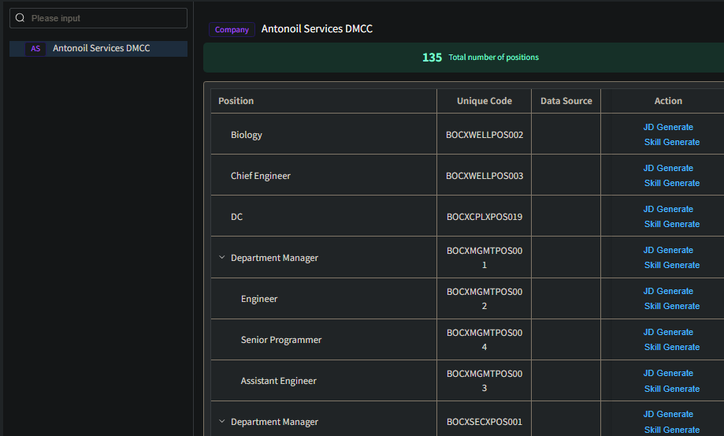
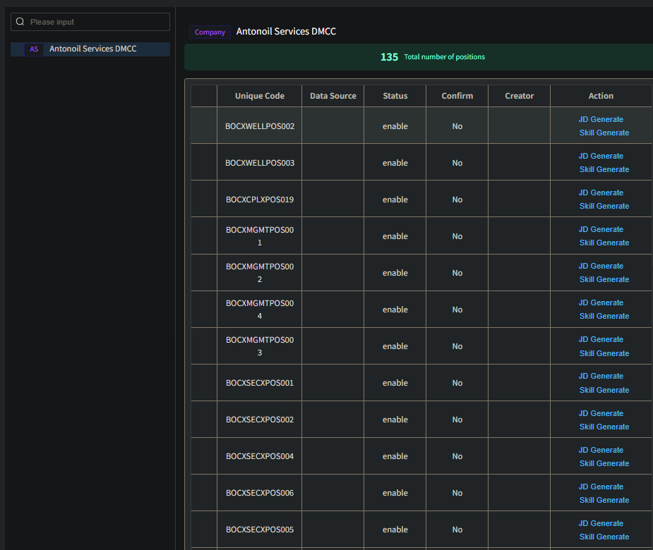

## Element UI + Vue3 实现大数据列表

### 任务1：JD 列表优化（添加字段）

过程：  

1. 调用新的 api 来获取新的数据

发现了问题，原本的 api 只需要传入一个 compId 就能获取到所有的参数（并且页面展示也是直接一个可滚动表格展示所有内容），而新的 api 需要传入 compId + pageNo + pageSize。  

那就改为列表来显示数据：  
没事了，新的 api 不管传入什么 pageNo、pageSize，仍然是返回所有的数据

{
    "id": 2819,
    "name": "Senior Wells Manager",
    "code": "AOSIWELLSSECPOS001",
    "sort": 0,
    "status": 0,
    "compId": 123,
    "companyName": null,
    "comShortname": null,
    "deptId": 646,
    "deptName": null,
    "depShortname": null,
    "sectId": null,
    "sectName": null,
    "shortName": null,
    "parentId": 2746,
    "ancestors": null,
    "dataSource": null,
    "jdPublished": null
}

返回的数据结构如上，请你帮我增加 Unique Code 列（值为"code": "AOSIHRXXPOS058" 的值），还有 Confirm 列（jdPublished 为 null 或 false 时，值为No；为 True 时，值为 Yes）

氯雷他定

tai nuo er

抗过敏

## 临时文件

<template>
  

    <Splitpanes class="default-theme">
      <Pane :size="26" class="!bg-white">
        <el-scrollbar class="!app-main-height p-2.5" height="calc(100vh)">
          

            <el-input
              v-model="deptName"
              :placeholder="t('sys.user.deptNamePH')"
              clearable
              class="mb-[20px]"
            >
              <template #prefix>
                <Icon class="mr-5px" icon="ep:search" />
              </template>
            </el-input>
          

          

            <el-tree
              ref="postTreeRef"
              :data="deptOptions"
              :props="{ label: 'label', children: 'children' }"
              :expand-on-click-node="false"
              :default-expanded-keys="defaultExpand"
              :filter-node-method="filterNode"
              node-key="virtualId"
              highlight-current
              @node-click="handleNodeClick"
            >
              <template #default="{ node }">
                

                  

                    <el-tag
                      v-if="node.data.level === OrgType.Company"
                      :title="node.data.shortName"
                      :style="{
                        '--el-tag-text-color': '#630EB8',
                        '--el-tag-bg-color': '#F3F1FF',
                        '--el-tag-border-color': '#D3CEF0'
                      }"
                    >
                      {{ node.data.shortName ? node.data.shortName : 'Company' }}
                    </el-tag>
                    <el-tag
                      v-else-if="node.data.level === OrgType.Department"
                      :title="node.data.shortName"
                    >
                      {{ node.data.shortName ? node.data.shortName : 'Dept' }}
                    </el-tag>
                    <el-tag v-else-if="node.data.level === OrgType.Section" type="info">
                      {{ 'Section' }}
                    </el-tag>
                  

                  
                    {{ node.label }}
                

              </template>
            </el-tree>
          

        </el-scrollbar>
      </Pane>
      <Pane class="!app-main-height !bg-white">
        <el-scrollbar class="app-main-height p-2.5" height="calc(100vh)">
          

            

              <el-tag
                v-if="selDept?.level === OrgType.Company"
                :style="{
                  '--el-tag-text-color': '#630EB8',
                  '--el-tag-bg-color': '#F3F1FF',
                  '--el-tag-border-color': '#D3CEF0'
                }"
              >
                {{ t('global.company') }}
              </el-tag>
              <el-tag v-if="selDept?.level === OrgType.Department">
                {{ t('sys.user.department') }}
              </el-tag>
              <el-tag v-else-if="selDept?.level === OrgType.Section" type="info">
                {{ t('sys.user.section') }}
              </el-tag>
              {{ selDept?.label }}
            

          

          <OrgTotalBar :number="postTotal" :text="t('sys.post.totalTip')" />

          <!-- 搜索工作栏 -->
          <ContentWrap>
            <el-form class="-mb-15px" :model="queryParams" :inline="true">
              <el-form-item label="岗位名称" prop="name">
                <el-input
                  v-model="queryParams.name"
                  placeholder="请输入岗位名称"
                  clearable
                  class="!w-240px"
                />
              </el-form-item>
              <el-form-item label="岗位编码" prop="code">
                <el-input
                  v-model="queryParams.code"
                  placeholder="请输入岗位编码"
                  clearable
                  class="!w-240px"
                />
              </el-form-item>
              <el-form-item>
                <el-button @click="resetQuery">
                  <Icon icon="ep:refresh" class="mr-5px" /> Reset
                </el-button>
              </el-form-item>
            </el-form>
          </ContentWrap>

          <!--JD列表-->
          <ContentWrap>
            <el-table v-loading="loading" :data="positionList" row-key="id">
              <!--岗位名称-->
              <el-table-column :label="t('sys.post.postName')" prop="name" min-width="360" />

              <!--岗位编码-->
              <el-table-column prop="code" align="center" label="Unique Code" width="150" />

              <!--数据来源-->
              <el-table-column
                prop="dataSource"
                align="center"
                :label="t('sys.company.dataSource')"
                width="110"
              />

              <!-- 状态 -->
              <el-table-column align="center" label="Status" width="110">
                <template #default="scope">
                  enable
                  disable
                </template>
              </el-table-column>

              <!-- 是否已经创建JD -->
              <el-table-column align="center" label="Confirm" width="110">
                <template #default="scope">
                  Yes
                  No
                </template>
              </el-table-column>

              <!--创建者-->
              <el-table-column
                prop="createBy"
                align="center"
                :label="t('sys.company.creator')"
                width="110"
              />

              <!--操作-->
              <el-table-column
                :label="t('global.action')"
                min-width="180"
                align="center"
                class-name="small-padding fixed-width"
                fixed="right"
              >
                <template #default="scope">
                  <!--JD生成-->
                  <el-button
                    link
                    type="primary"
                    @click="handleJDGenerate(scope.row.id, scope.row.name)"
                  >
                    JD Generate
                  </el-button>

                  <!--技能生成-->
                  <el-button
                    link
                    type="primary"
                    @click="handleSkillGenerate(scope.row.id, scope.row.name)"
                  >
                    Skill Generate
                  </el-button>
                </template>
              </el-table-column>
            </el-table>
          </ContentWrap>
        </el-scrollbar>
      </Pane>
    </Splitpanes>
  

</template>

### 再次vi

<template>
  

    <Splitpanes class="default-theme">
      <Pane :size="26" class="!bg-white">
        <el-scrollbar class="!app-main-height p-2.5" height="calc(100vh)">
          

            <el-input
              v-model="deptName"
              :placeholder="t('sys.user.deptNamePH')"
              clearable
              class="mb-[20px]"
            >
              <template #prefix>
                <Icon class="mr-5px" icon="ep:search" />
              </template>
            </el-input>
          

          

            <el-tree
              ref="postTreeRef"
              :data="deptOptions"
              :props="{ label: 'label', children: 'children' }"
              :expand-on-click-node="false"
              :default-expanded-keys="defaultExpand"
              :filter-node-method="filterNode"
              node-key="virtualId"
              highlight-current
              @node-click="handleNodeClick"
            >
              <template #default="{ node }">
                

                  

                    <el-tag
                      v-if="node.data.level === OrgType.Company"
                      :title="node.data.shortName"
                      :style="{
                        '--el-tag-text-color': '#630EB8',
                        '--el-tag-bg-color': '#F3F1FF',
                        '--el-tag-border-color': '#D3CEF0'
                      }"
                    >
                      {{ node.data.shortName ? node.data.shortName : 'Company' }}
                    </el-tag>
                    <el-tag
                      v-else-if="node.data.level === OrgType.Department"
                      :title="node.data.shortName"
                    >
                      {{ node.data.shortName ? node.data.shortName : 'Dept' }}
                    </el-tag>
                    <el-tag v-else-if="node.data.level === OrgType.Section" type="info">
                      {{ 'Section' }}
                    </el-tag>
                  

                  
                    {{ node.label }}
                

              </template>
            </el-tree>
          

        </el-scrollbar>
      </Pane>
      <Pane class="!app-main-height !bg-white">
        <el-scrollbar class="app-main-height p-2.5" height="calc(100vh)">
          

            

              <el-tag
                v-if="selDept?.level === OrgType.Company"
                :style="{
                  '--el-tag-text-color': '#630EB8',
                  '--el-tag-bg-color': '#F3F1FF',
                  '--el-tag-border-color': '#D3CEF0'
                }"
              >
                {{ t('global.company') }}
              </el-tag>
              <el-tag v-if="selDept?.level === OrgType.Department">
                {{ t('sys.user.department') }}
              </el-tag>
              <el-tag v-else-if="selDept?.level === OrgType.Section" type="info">
                {{ t('sys.user.section') }}
              </el-tag>
              {{ selDept?.label }}
            

          

          <OrgTotalBar :number="postTotal" :text="t('sys.post.totalTip')" />

          <!-- 搜索工作栏 -->
          <ContentWrap>
            <el-form class="-mb-15px" :model="queryParams" :inline="true">
              <el-form-item label="岗位名称" prop="name">
                <el-input
                  v-model="queryParams.name"
                  placeholder="请输入岗位名称"
                  clearable
                  class="!w-240px"
                />
              </el-form-item>
              <el-form-item label="岗位编码" prop="code">
                <el-input
                  v-model="queryParams.code"
                  placeholder="请输入岗位编码"
                  clearable
                  class="!w-240px"
                />
              </el-form-item>
              <el-form-item>
                <el-button @click="resetQuery">
                  <Icon icon="ep:refresh" class="mr-5px" /> Reset
                </el-button>
              </el-form-item>
            </el-form>
          </ContentWrap>

          <!--JD列表-->
          <ContentWrap>
            <el-table
              v-loading="loading"
              :data="positionList"
              row-key="id"
              border
              default-expand-all
            >
              <!--岗位名称-->
              <el-table-column :label="t('sys.post.postName')" prop="name" min-width="360" />

              <!--岗位编码-->
              <el-table-column prop="code" align="center" label="Unique Code" width="150" />

              <!--数据来源-->
              <el-table-column
                prop="dataSource"
                align="center"
                :label="t('sys.company.dataSource')"
                width="110"
              />

              <!-- 状态 -->
              <el-table-column align="center" label="Status" width="110">
                <template #default="scope">
                  enable
                  disable
                </template>
              </el-table-column>

              <!-- 是否已经创建JD -->
              <el-table-column align="center" label="Confirm" width="110">
                <template #default="scope">
                  Yes
                  No
                </template>
              </el-table-column>

              <!--创建者-->
              <el-table-column
                prop="createBy"
                align="center"
                :label="t('sys.company.creator')"
                width="110"
              />

              <!--操作-->
              <el-table-column
                :label="t('global.action')"
                min-width="180"
                align="center"
                class-name="small-padding fixed-width"
                fixed="right"
              >
                <template #default="scope">
                  <!--JD生成-->
                  <el-button
                    link
                    type="primary"
                    @click="handleJDGenerate(scope.row.id, scope.row.name)"
                  >
                    JD Generate
                  </el-button>

                  <!--技能生成-->
                  <el-button
                    link
                    type="primary"
                    @click="handleSkillGenerate(scope.row.id, scope.row.name)"
                  >
                    Skill Generate
                  </el-button>
                </template>
              </el-table-column>
            </el-table>
          </ContentWrap>
        </el-scrollbar>
      </Pane>
    </Splitpanes>
  

</template>
